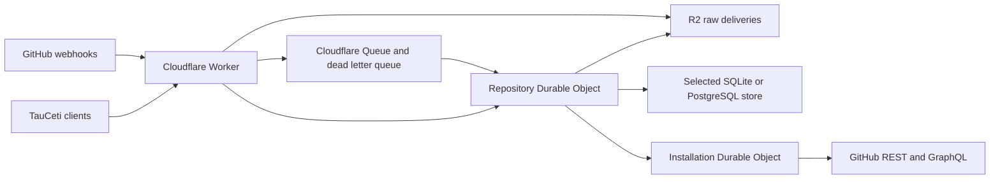

# Shared GitHub state

The production Tau Ceti mirror publishes `/v1/query` and `/v1/query_batch` reads
for `TauCetiProject/TauCeti` without a client token. Ordinary Tau Ceti workers
therefore need no state-service configuration. `PUBLIC_READ_REPOSITORIES` is an
explicit JSON list of public repository names, intersected with the installed
`ALLOWED_REPOSITORIES`; it is empty unless the operator configures it. Private
repositories and all administration, health, changes and activity APIs retain
their existing authentication. Custom deployments should publish only data
intended for anonymous readers. Anonymous queries serve existing mirrored data;
they never renew demand, schedule hydration or configure a repository. Public
and authenticated reads share stable, byte-bounded pagination. Temporary
continuation pages are stored in private R2 and expire after ten minutes.
Authenticated clients retain background demand.

Public queries require the `PUBLIC_QUERY_LIMIT` binding (1,200 queries per minute per client IP, including individual batch queries). Identical reads share preparation and public reads use a separate page cache bounded at sixteen entries and 12 MiB of serialized results. Shared-IP fleets have room for normal survey, dispatch and continuation bursts; public reads have no separate concurrency refusal or total-snapshot size cutoff. Set `PUBLIC_READ_REPOSITORIES = "[]"` explicitly to revoke public access; `keep_vars` preserves omitted deployment variables.


Reporting clients can use authenticated `POST /v1/activity` with
`{"repository":"TauCetiProject/TauCeti","numbers":[1,2]}` (maximum 500 numbers).
It returns stored PR headers, original observation timestamps and missing IDs.
This route is observation-only: no repository configuration, demand renewal,
repair jobs, upstream validation or installation-scheduler access. Closed PRs
without cached merge evidence have no landing timestamp. See
[activity reporting](../../docs/activity.md); reporting clients must retain stale
data or unknowns when unavailable, without direct GitHub fallback.

The Cloudflare service receives GitHub webhooks and serves repository state to
TauCeti clients. Production and test each use a separate private, read-only
GitHub App installation on `TauCetiProject/TauCeti`. The service owns those read
quotas. Authoring and commenting continue with the workers' existing credentials.



The [Neon PostgreSQL backend](POSTGRES.md) retains the public API and installation
quota owner. The production repository moved to PostgreSQL on 2026-10-26; the
[accepted migration receipt](validation/migration-production-release-2026-10-26.json)
records the checks and retained recovery data. Provisioning, test isolation,
restore evidence, the performance gate and generation fencing are documented
in [POSTGRES.md](POSTGRES.md).

## Data and recovery

The Worker verifies the raw-body HMAC before durably writing a delivery to R2
and submitting its pointer to the queue. The repository object acknowledges
only after recording the event and repair jobs. Delivery IDs make replays
idempotent; timestamps and tombstones protect newer records from older events
and API responses. Large identifiers retain their decimal digits.

The selected repository store holds indexed resources, collection membership and coverage, repair
jobs with pagination state, a seven-day change journal, and stable query
snapshots. Initial inventories and histories publish complete coverage after
all pages finish. A failed page preserves the previous complete collection.
Snapshots paginate at 500 rows or approximately 1.49 MB per page. Continuation
pages are written to private R2 (at most four uploads at a time), never to
SQLite; continuation reads individual pages rather than repeatedly decoding the
entire inventory.
Concurrent queries at the same revision share a snapshot.

PR and issue headers and commit statuses update from webhook payloads. A
changed PR does not start a full repository survey. Full inventories reconcile
hourly; overlapping deltas catch missed updates.

Repository-wide discovery batches the compact fragments needed by dirty review
projections alongside its related metadata. Changed summaries retain exact stored
collection membership and ordering without separate database round trips for
every PR's issue and review history. These reads do not fetch GitHub data or wait
for background hydration; incomplete histories remain explicitly incomplete.

GitHub Actions runs and jobs and check runs are not mirrored. No client reads
them, and keeping every run, job and check run for every commit was about 90%
of the repository database. CI webhooks are acknowledged without being stored,
and `checks`, `workflow_runs` and `workflow_jobs` queries answer
`status: "unavailable"` with reason `not_mirrored`, so a client uses its direct
GitHub path rather than an empty result.
Existing CI rows are removed, without an archive, with the `ci_resources`,
`ci_members`, `ci_collections` and `ci_meta` cleanup classes.
Quiet closed PRs also stop periodic history and head polling once their
baseline is complete. Webhook updates continue, and renewed client demand
reactivates background reconciliation while returning the stored result.

Raw deliveries are eligible for expiry after fourteen days only after durable
replay input or an explicit invalid-event disposition exists. There are no daily
R2 archives; any left from earlier versions expire. Staging pages after one day, and query cursors after ten minutes. R2 cursor
objects expire after a one-minute grace period and have their own retention sweep.
At the SQLite size limit, stored reads keep working and ingestion parks durably in R2
until headroom returns. The [storage recovery runbook](https://github.com/TauCetiProject/TauCetiWorker/blob/main/docs/github-state-recovery.md)
describes the admin endpoints and the example harness's recovery commands. Active resource spill objects
remain readable while referenced by the SQL state. The existing minute cron now
retries held and parked input, reconciles retained raw/DLQ deliveries, and probes
full-mode headroom automatically. See [scheduled recovery](../../docs/github-state-recovery.md)
for ownership, prepared status, release evidence, and rollback requirements.

The installation object owns token refresh, all GitHub read requests,
per-resource quotas, API selection, and accounting. Every GraphQL query asks
for `rateLimit.cost`; concurrent header differences are not point accounting.
REST 304 responses record zero primary points. Similar quota pressure permits
selection by measured latency; scarce pools are preserved for operations with
no alternative API. Batch histories and reactions reduce request cost. Nested
or outer overflow continues through the normal paginated reader.

Primary exhaustion defers that pool and tries a compatible alternative.
REST-exhausted flat review histories promote the existing GraphQL thread
reconciler, which supplies the same flat collection without duplicating a
reader. REST-capable batches can also move to REST before GraphQL exhaustion
when their measured cost/headroom makes that pool preferable.
Secondary limits pause both pools after the actual rejection and honor
`Retry-After`. HTTP-200 GraphQL quota errors are also recognized. Known data
remains available while background reads wait. New content, concurrency,
compute, point, or primary quota categories appear in protected health telemetry
and structured logs. There is no preemptive pacing of GitHub writes.
Exhaustion midway through pagination restarts the staged read in a compatible
pool; it never mixes REST pagination URLs with GraphQL cursors or publishes a
partial collection. Token renewal respects its own exhausted quota too.

Background scheduling uses requested-gap, active-change, verification, and
archival lanes, weighted 8:4:2:1 with unused shares borrowed by eligible work.
Missing requested coverage is promoted immediately without revoking actual
quota cooldowns or pagination. Old numeric priorities cannot keep historical
CI ahead of worker-needed histories. Each alarm launches up to sixteen
requests in four-request waves during a ten-second launch window. Network
calls run outside installation-wide locks; atomic quota reservations and
expiring job leases protect concurrent requests. Large nested thread histories
checkpoint one comment page per quantum instead of monopolizing a turn.

Maintenance independently promotes at most 64 missing status/comment collections
for current open PRs into the requested lane per turn. Already requested work is
excluded so successive turns advance through the inventory. Existing attempts,
pagination, leases, and retry deadlines are retained. Among real requests,
three turns out of four prefer newer demand and one retains oldest-due ordering;
maintenance work sorts behind real reads without creating demand records or user
latency samples. Its completion retains ordinary refresh intervals. The candidate
scan runs outside the writer transaction; promotion rechecks current state atomically.
Maintenance uses the requested lane's share but yields to active work when another
preferred lane is empty. Quota-deferred dependencies retain their demand provenance.
The existing weighted shares between lanes remain unchanged. Expiry and coverage
preparation precede the launch window rather than consuming it before jobs start.

Webhook ingestion collects each event's repair requests and schedules them with
bulk coverage, demand and job lookups after its resource changes. The event's
receipt, resources, membership and repair obligations remain one atomic commit;
retry deadlines, pagination and existing ownership are preserved. Successful
commits update a bounded latest-minute aggregate for each event type, exposed
as `ingestion` in protected PostgreSQL health. When that type next appears in a later minute,
`repository_ingest_summary` logs its completed bucket. Each bucket records committed
deliveries, application SQL round trips (excluding transaction setup/commit), and
elapsed time from application entry through commit and connection cleanup. These
are I/O-inclusive measurements; CPU is not measured. SQLite does not supply
the PostgreSQL query counter. Buckets carry their minute timestamp and can be
old; these process-local, best-effort aggregates can lose the last quiet bucket
on eviction or undercount an uncertain commit. Existing repair-arrival counters
can also include rolled-back attempts. Use durable receipts/jobs and fixed-cohort
coverage for acceptance measurements, rather than treating diagnostic counters
as a complete ledger. See [ingestion measurements](INGEST-PERFORMANCE.md).

PostgreSQL cache misses return stored or unavailable results without awaiting
writer admission for demand bookkeeping. One repository owner coalesces readers,
committing demand and initial job creation together in small groups. Failed
groups retain pending intent for a later read or the existing cron tick; no new
timer or hydration prerequisite is introduced. Uncommitted intent is local to
the instance; ordinary missing-coverage maintenance and later reads remain its
restart backstop. A bookkeeping memo never establishes complete coverage, and
an actual miss bypasses it immediately. Public and migration shadow reads do
not create demand.

An owner-level repair coordinator claims complete upstream groups before sending
requests, preserving four-group parallelism and normal batch sizes. A slot spans
fetch, preparation, publication and cleanup. Finishing one group immediately
refills its slot while other groups continue. Companion claims and lease cleanup
use bulk statements with the existing generation and key/token checks.
Writer logs distinguish demand, ingress, repair, publication and other callers
using bounded purpose names, without recording queries or payloads.

Alarm/tick handlers return after finite scheduling work. The dispatch count
bounds a scheduling quantum; productive work continues automatically across
quanta, with bounded coverage and maintenance between them. Full slots pause the
quantum until a completion, without repeatedly selecting due backlog or waiting
inside an alarm handler. Ordinary ticks retain expiry and restart recovery.
Active local key/token ownership prevents duplicate fetches after persisted lease
expiry. Existing repair/publication transactions renew matching leases near
expiry, without a heartbeat timer. Each committed member releases its local
ownership so a newer dirty generation can proceed before its siblings finish.
Protected `repair_scheduler` health diagnostics report active groups and members,
pending transport hops, selections, launch/maintenance counts, lease-renewal row
updates and accumulated slot milliseconds by the group leader's lane. These are
instance counters, include active group time and reset on owner replacement;
they are neither a durable completion ledger nor scheduling inputs.

Finite per-key/API attempt records prevent no-progress deferral and restart
loops; ordinary external wakes refresh these records. A confirmed member-data
error committed to a future ordinary retry can advance independent ready work
across a quantum; its retry settlement is recorded separately from data/checkpoint
progress and completed coverage. Backend failures, unknown outcomes and
unclassified unavailable responses do not earn this continuation credit.
Explicit data validation uses additive `failure_kind` metadata; a malformed or
truncated HTTP body and a generic JavaScript exception earn no credit. Replay
eligibility is broader than continuation eligibility. Failed untouched tails
remain excluded across internal chains until an ordinary external wake.
Quota deferrals retain their exact deadlines and carry additive
installation/pool/query scope. Unknown
scope retains ordinary bounded selection. Only a known installation reservation
restriction can use an optional bounded SQLite availability hint. PostgreSQL
receives best-effort capacity-release notifications, normally one registered
recipient per released reservation, with coalesced wakes at existing retry
deadlines when necessary. Notifications and hints never grant reservations or
become prerequisites for ordinary work; lost notifications recover through cron.
Capacity wakes preserve unrelated failed-tail and API-path records even after
a turn closes. They clear only capacity rejections known when the wake arrived;
a newer rejection cannot be cleared by an older pending hint. Partial slot
occupancy retains the owner-reported deadline without repeated empty maintenance.
The existing runner-capacity scan also registers bounded local wake recipients
after a real installation-reservation rejection. Its actual retry deadline stays
unchanged. Once that deadline passes, a still-full installation retains the
eligible registration rather than issuing another futile request and moving the
retry deadline forward. Each release wakes at most one eligible recipient per
released slot, in registration order; local recipients need no outgoing callback.
The existing timed fallback remains, failed optional availability checks fall
back to the real request, and every request still acquires its ordinary quota
reservation. This adds no reservation queue, grant or ordinary-request preflight.

Each repair archive/installation transport hop has a conservative fifteen-minute
bound, independent of total history size or queue age. The installation owner's
fourteen-minute RPC bound lets a stalled dependency recover first. Verified
transport cancellation is preferred; an uncancellable expired hop retains its
slot until automatic owner recovery, after durable key/token backoff where the
writer is usable. Unconfirmed outcomes retain ordinary lease recovery. A normal
member failure drains its neighboring archive operations without resetting the
owner. Successful paginated histories have no total-duration deadline.
Cancellable expired hops allow at most two seconds for actual cancellation
acknowledgement after cleanup before last-resort recovery; this applies only to
an already-failed transport and never to healthy work or job eligibility.

Full upstream batches retain their existing sizes. Small, independent page-one
issue-comment, status and reaction histories publish in transactions bounded by
eight members, 256 KiB of prepared data and 128 rows. Partially filled chunks run
immediately; oversized, paginated and coupled thread results use the individual
path. Preparation and staging remain outside the writer. Each member has its
own consumable input/cache, sharing transaction revisions and the change journal.
Leases are checked under the writer; a newer webhook generation can still publish
safely and leave its new repair due. Committed publication and deferral/routing
bookkeeping release only their own key/token leases atomically.

If non-publication work is actually queued on the writer, publication ends at
the next whole-history boundary and immediately queues the prepared remainder
through the existing FIFO lane. Each admission publishes at least one owned
member when one remains, skipping stale leases without an empty intermediate
commit. This changes chunk size without a wait, admission gate or queue reorder.
The protected `grouped_publication` health counters record committed admissions,
members, maximum members and queued-work yields since instance startup. They
are best-effort diagnostics, include refreshes of complete histories and can
undercount uncertain commits; they are not a missing-history drainage ledger.

A confirmed healthy member-data rollback permits one individual replay from
fresh input. Fences, backend failures and uncertain commits use durable recovery;
they do not trigger a replay loop or one connection attempt per remaining result.
Unclassified failures retry only the attempted chunk; untouched members retain
their attempts and deadlines. Adapter-classified backend failures retain the
established unfinished-group exponential retry, avoiding one costly backend
failure per tiny chunk under a persistent timeout. Confirmed member-data rollback
takes precedence over backend classification and still isolates healthy siblings.
Committed or deferred outcomes remain protected by key/token checks; failed
cleanup retains ordinary lease-expiry recovery. Completion metrics merge after commit; an uncertain commit
can undercount them, so fixed durable coverage remains the acceptance evidence.
Unsettled failed-tail members are excluded from leader/companion selection for
the rest of that alarm turn. Already committed new generations and API transitions
remain eligible. Next-alarm calculation excludes immediately due failed tails,
while retaining future retry/lease deadlines and earlier incoming alarms. A
failed tail cannot repeatedly refetch in the same turn or drive its own 100-ms
alarm loop. Existing cron/tick/retry continuation starts a fresh turn; no
persisted cooldown or new timer is added, and unrelated work remains eligible.
Compatible quota/routing/retry bookkeeping also uses bounded bulk statements,
preserving per-member deadlines, attempt increments and wait reasons. This changes
transaction cost, not the quota owner's decisions. A failed bookkeeping commit
retries its captured decision once, preserving capacity semantics and the exact
deadline. If its cause is a backend failure, the same recovery admission applies
ordinary backoff to the still-owned tail after saving those exact decisions. See
[publication measurements](PUBLICATION-PERFORMANCE.md).

Compact surveys immediately include exact-head commit statuses received by webhook,
even before the first full status collection is hydrated. The per-PR
`statusCheckRollupCoverage` field distinguishes `webhook_observed`, `complete`, and
`unavailable`. Newer contexts override older snapshots, including failures; unrelated
head SHAs never contribute. This does not declare complete comment histories or
change the coverage gate on full status queries. Public surveys remain read-only
and never wait for GitHub or hydration. Authenticated surveys also return stored
facts without awaiting per-PR dependency scheduling. The existing maintenance owner
backfills missing open-head coverage, and selected-PR reads register real demand
through their normal path. Survey validators include a representation
version so old empty-status responses cannot survive deployment through a 304.

`RECONCILIATION_SETTINGS` is an optional JSON variable with `concurrency`
(default/max 4), `dispatches` (default 16, max 100), and four positive `weights`
(default `[8,4,2,1]`). Legacy `launch_ms` values still load and appear in settings;
the elapsed launch window is retired and does not impose a cooldown. Settings
affect background reads only. Health includes lane eligibility, oldest requested age,
repair arrivals/completions/cancellations, wait reasons, requested latency p95,
and measured cost/latency by query shape and batch size.

Repair publication releases buffered staging text as it decodes pages and drops
its decoded inventory before preparing dependent jobs. PostgreSQL publication
cache groups contain at most 128 rows and 2 MiB each of old body bytes and new
serialized string storage (allowing one oversized row). Old body sizes determine
the groups before bodies are fetched, including compact listings over large
stored detail rows. Membership is decided from the final stored resource state.
Follow-up jobs are deduplicated once and processed in groups of at most 512,
reading only IDs, states, membership and scheduling fields. They do not reload
PR bodies or nested job cursors. All writes remain in the same transaction.

These limits describe PostgreSQL cache-group inputs. Decoded inventory and
objects used for merging or serialization also consume memory.

The SQLite publication fixture records process memory, a pre-refresh baseline,
and Node/V8 heap-limit metadata. It runs with a 96 MiB Node old-space flag without
forced garbage collection. A historical CI run with that flag sampled
140,267,192 bytes (133.8 MiB) of Node heap usage. Process-wide samples can include
startup allocations and uncollected garbage; Worker-isolate capacity requires
separate runtime evidence. The
[publication evidence](validation/publication-memory-native-2026-10-20.json) also
records native `recent_prs` collection/job completion observations. Those may
follow an unchanged response and do not establish full publication or measure
isolate memory usage.

For an isolate-reset investigation, temporarily set `RECONCILIATION_TRACE` to
`"true"`. Background alarm and publication stage logs contain only the backend,
operation, page number, and start timestamp. They exclude query arguments, keys,
cursors, credentials, and payloads. Tracing is disabled by default; remove the
variable after collecting the diagnostic trace.
Set it in the selected environment's Wrangler `vars` and deploy; changing the
variable restarts the object. Traces include aggregate row, repair and staged-character
counts. `publication_applied` precedes commit; only `refresh_committed` confirms
the transaction completed. Background storage work can continue after
`alarm_complete`; its completion is recorded separately as `storage_prepared`.
An opaque random `trace` correlates stages of the same job object within a
dispatch, including concurrent jobs with identical operation/page metadata.
`publication_encode_pages` records the staged size before the encoding scan.

## Client behavior

Clients request the newest available service data, including conditional reads.
They do not impose an age threshold or validate with GitHub before spending.
Unavailable coverage, invalid client credentials, or failed transport uses the
existing direct facade. A shared circuit breaker bounds repeated outage probes.
Healthy pagination can exceed the initial five-second outage interval; each
request and stalled interval remains bounded. Partial histories never become
empty results. The direct facade and service share the field/route catalog in
`tauceti_worker/github_catalog.json`.

Worker surveys use a materialized, roadmap-filtered fact snapshot instead of
fetching every PR's full comment histories. The scheduling cascade remains in
the worker for full service-outage fallback. See [compact surveys](../../docs/compact-surveys.md)
for scope rules, per-history coverage, migration, telemetry, and cross-language
contract tests.
The v1 response keeps `review.markers` as an empty array for existing clients.
Coordination comments and claims in older cached projections do not populate it.
Survey ETags include a representation tag so an older markerless cached response
is replaced once, after which ordinary conditional reads return 304 again.

```toml
max_open_prs = 128
github_state_url = "https://github-state.taucetiproject.org"
github_state_token_file = "/home/kim/.config/tauceti-github-state/client-token"
```

The cutoff defaults to eight and must be a positive integer. Read-policy
configuration changes wait for an idle round boundary; they must not interrupt
paid sessions. Direct quota failures retain publication intents privately,
including copied body files, so replay does not repeat paid authoring. Ambiguous
creates reconcile with GitHub before replay; opaque ambiguous mutations remain
pending rather than being blindly duplicated.

Shared host snapshots of TauCetiRoadmap refresh hourly and review references
every fifteen minutes. These are immutable, self-contained read-only checkouts
with leases for active users. A fetch failure can reuse the existing snapshot.

## Operator commands

Registration forms already contain the organization, webhook URL, read
permissions, and subscriptions. Register production and test separately:

- https://github-state.taucetiproject.org/setup/register
- https://github-state-test.taucetiproject.org/setup/register

Exchange the one-use manifest code on stdin. Credentials stay under the private
`~/.config/tauceti-github-state[-test]` directory. Node converts GitHub's RSA key
to PKCS8 when system OpenSSL is unavailable. `finish-exchange` can recover from
a conversion failure without consuming another registration code.

```sh
python3 services/github-state/scripts/setup.py inspect --environment test
python3 services/github-state/scripts/setup.py deploy --environment test
python3 services/github-state/scripts/setup.py bootstrap --environment test
```

`inspect` discovers the installation and checks its permissions and selected
repository using App authentication. Deployment provisions resources
idempotently and uploads secrets without printing them. Wrangler keeps remote
variables, so later code deployments preserve the App and allowlist settings.

```sh
cd services/github-state
npm ci
npm test
npm run test:publication-memory
npm run deploy -- --env test
npm run deploy -- --env ''
```

`POST /v1/activity` also derives Lean LOC from complete cached PR file lists,
checking immutable file URLs against the PR's head/base and header totals.
Derived counts are cached by PR head/base and file-collection revision, with at
most 32 uncached computations per request. It reads stored resources only: no
client demand, upstream request, repair job, or closed-PR polling is created.

`/healthz` is public and exposes only service identity/version. `/v1/health`,
`/v1/query`, `/v1/query_batch`, and `/v1/changes` require a repository-scoped
client token. Valid credentials querying an unavailable repository scope get
a structured `status:unavailable` response with no data, so that scope cannot
poison outage handling for supported repositories. Invalid credentials still
return 401. `/admin/bootstrap`, `/admin/storage[/...]` and `/admin/ingress[/...]` require the separate admin credential.
Installation tokens and private keys never reach clients.

`allow_observed=true` remains accepted on `workflow_jobs` queries for protocol
compatibility, and other operations still reject it; the answer is
`not_mirrored`.

The test environment enables `/admin/reference`: a protected, uncached
catalog-only read through its installation quota owner. It requires the admin
token and `REFERENCE_READS=true`; production disables it by default. Reference
reads share test accounting and quota reservations, and never repair the test
mirror before comparing it. No arbitrary API paths or queries are proxied. Catalog-generated measurement
batches (up to 100 aliases and twenty initial review threads) use this same
owner, returning only cost/latency/overflow summaries. `measure.py` no longer
mints an independent installation token or spends quota outside that owner.


## Measurements and worker rollout

Service measurement commands remain in `scripts/measure.py`, `measure_surveys.py`,
`measure_capacity.py` and `observe_reconciliation.py`.
`npm run benchmark:history-demand` compares a full baseline source snapshot with
the current implementation on isolated PostgreSQL schemas. It measures cache-miss
responses, durable demand, fixed-cohort repair and companion claims; upstream
responses are fixtures and it makes no GitHub requests. See
[the method and results](HISTORY-DEMAND-PERFORMANCE.md) for scope and limitations.
The example worker's process-manager rollout and shadow commands live in
[TauCetiWorker/services/github-state/scripts](https://github.com/TauCetiProject/TauCetiWorker/tree/main/services/github-state/scripts).
Downstream deployment and credential setup are documented in the
[manual](../../docs/project-setup.md#github-state).

The [migration source runbook](../../docs/github-state-migration.md) describes
S2's supervised export/import, exclusive write switch, production gates and recovery protocol.
Source verification does not select PostgreSQL or constitute a release receipt.

### Shared runner-capacity discovery

`GET /v1/runner-capacity?repository=OWNER/REPO` requires an existing client token
authorized for that configured repository. Its installation owner performs one
bounded organization inventory and shares the result for two minutes, coalescing
concurrent requests. It counts running GitHub-hosted jobs, excluding Namespace
and self-hosted labels, across the repositories visible to the installation.
The current deployment organization has only public repositories. Adding private
repositories requires granting the installation visibility to those repositories.

The response includes `complete`, `organization`, `busy`, `observed_at`, `retry_at`,
and refresh request counts. This is an advisory observation, not a reserved slot
or an atomic snapshot. Missing pages or quota rejection produce HTTP 503 with
`complete:false`, never a partial count. Failed refreshes are cached for two minutes
(or a longer instructed cooldown). Routing version 2 also reports queued/running
Namespace build jobs and queued fleet targets from the same bounded scan, shared
by all pickers. Picker, recovery, publication, and finalizer control jobs are
excluded from the build count.

Refresh uses existing installation quota accounting, honors secondary cooldowns,
leaves at least 1,500 core requests for repository work, and spends at most 2,400
read attempts per rolling hour, including lost network responses on this operation. Brief request-slot
contention yields within the scan deadline rather than invalidating the snapshot. A scan is bounded to
80 requests, at most three simultaneous reads, and a 15-second launch window; individual requests retain their
existing timeout. There is no alarm, CI event storage, or new polling task.

Pickers retain bounded direct discovery when this view is unavailable. Visiting
ordinary reports/status does not invoke capacity discovery.
