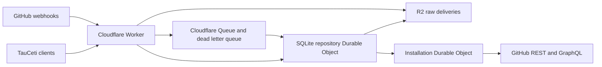

# Shared GitHub state

Reporting clients can use authenticated `POST /v1/activity` with
`{"repository":"TauCetiProject/TauCeti","numbers":[1,2]}` (maximum 500 numbers).
It returns stored PR headers, original observation timestamps and missing IDs.
This route is observation-only: no repository configuration, demand renewal,
repair jobs, upstream validation or installation-scheduler access. Closed PRs
without cached merge evidence have no landing timestamp. See
[activity reporting](../../docs/activity.md); reporting clients must retain stale
data or unknowns when unavailable, without direct GitHub fallback.

The Cloudflare service receives GitHub webhooks and serves repository state to
TauCeti clients. Production and test each use a separate private, read-only
GitHub App installation on `TauCetiProject/TauCeti`. The service owns those read
quotas. Authoring and commenting continue with the workers' existing credentials.



## Data and recovery

The Worker verifies the raw-body HMAC before durably writing a delivery to R2
and submitting its pointer to the queue. The repository object acknowledges
only after recording the event and repair jobs. Delivery IDs make replays
idempotent; timestamps and tombstones protect newer records from older events
and API responses. Large identifiers retain their decimal digits.

SQLite stores indexed resources, collection membership and coverage, repair
jobs with pagination state, a seven-day change journal, and stable query
snapshots. Initial inventories and histories publish complete coverage after
all pages finish. A failed page preserves the previous complete collection.
Snapshots paginate at 500 rows or approximately 1.49 MB per page. Continuation
pages are written to private R2 (at most four uploads at a time), never to
SQLite; continuation reads individual pages rather than repeatedly decoding the
entire inventory. Legacy SQL cursors stay readable until they expire.
Concurrent queries at the same revision share a snapshot.

PR and issue headers and commit statuses update from webhook payloads. A
changed PR does not start a full repository survey. Full inventories reconcile
hourly; overlapping deltas catch missed updates.

GitHub Actions runs and jobs and check runs are not mirrored. No client reads
them, and keeping every run, job and check run for every commit was about 90%
of the repository database. CI webhooks are acknowledged without being stored,
and `checks`, `workflow_runs` and `workflow_jobs` queries answer
`status: "unavailable"` with reason `not_mirrored`, so a client uses its direct
GitHub path rather than an empty result.
Existing CI rows are removed with the `ci_resources`, `ci_members`,
`ci_collections` and `ci_meta` cleanup classes. Each requires a verified class
export (`/admin/storage/export` with `class`), which archives only the rows
that class deletes; deletion covers exported rowids only, and resources only
when they were last observed before the export began.
Quiet closed PRs also stop periodic history and head polling once their
baseline is complete. Webhook updates continue, and renewed client demand
reactivates background reconciliation while returning the stored result.

Raw deliveries expire after fourteen days, daily snapshots after seven days,
staging pages after one day, and query cursors after ten minutes. R2 cursor
objects expire after a one-minute grace period and have their own retention sweep.
At the SQLite size limit, stored reads keep working and ingestion parks durably in R2
until headroom returns. The [storage recovery runbook](https://github.com/TauCetiProject/TauCetiWorker/blob/main/docs/github-state-recovery.md)
describes the admin endpoints and the example harness's recovery commands. Active resource spill objects
remain readable while referenced by the SQL state.

The installation object owns token refresh, all GitHub read requests,
per-resource quotas, API selection, and accounting. Every GraphQL query asks
for `rateLimit.cost`; concurrent header differences are not point accounting.
REST 304 responses record zero primary points. Similar quota pressure permits
selection by measured latency; scarce pools are preserved for operations with
no alternative API. Batch histories and reactions reduce request cost. Nested
or outer overflow continues through the normal paginated reader.

Primary exhaustion defers that pool and tries a compatible alternative.
REST-exhausted flat review histories promote the existing GraphQL thread
reconciler, which supplies the same flat collection without duplicating a
reader. REST-capable batches can also move to REST before GraphQL exhaustion
when their measured cost/headroom makes that pool preferable.
Secondary limits pause both pools after the actual rejection and honor
`Retry-After`. HTTP-200 GraphQL quota errors are also recognized. Known data
remains available while background reads wait. New content, concurrency,
compute, point, or primary quota categories appear in protected health telemetry
and structured logs. There is no preemptive pacing of GitHub writes.
Exhaustion midway through pagination restarts the staged read in a compatible
pool; it never mixes REST pagination URLs with GraphQL cursors or publishes a
partial collection. Token renewal respects its own exhausted quota too.

Background scheduling uses requested-gap, active-change, verification, and
archival lanes, weighted 8:4:2:1 with unused shares borrowed by eligible work.
Missing requested coverage is promoted immediately without revoking actual
quota cooldowns or pagination. Old numeric priorities cannot keep historical
CI ahead of worker-needed histories. Each alarm launches up to sixteen
requests in four-request waves during a ten-second launch window. Network
calls run outside installation-wide locks; atomic quota reservations and
expiring job leases protect concurrent requests. Large nested thread histories
checkpoint one comment page per quantum instead of monopolizing a turn.

`RECONCILIATION_SETTINGS` is an optional JSON variable with `concurrency`
(default/max 4), `dispatches` (default 16, max 100), `launch_ms` (default 10000,
max 30000), and four positive `weights` (default `[8,4,2,1]`). Settings affect
background reads only. Health includes lane eligibility, oldest requested age,
repair arrivals/completions/cancellations, wait reasons, requested latency p95,
and measured cost/latency by query shape and batch size.

## Client behavior

Clients request the newest available service data, including conditional reads.
They do not impose an age threshold or validate with GitHub before spending.
Unavailable coverage, invalid client credentials, or failed transport uses the
existing direct facade. A shared circuit breaker bounds repeated outage probes.
Healthy pagination can exceed the initial five-second outage interval; each
request and stalled interval remains bounded. Partial histories never become
empty results. The direct facade and service share the field/route catalog in
`tauceti_worker/github_catalog.json`.

Worker surveys use a materialized, roadmap-filtered fact snapshot instead of
fetching every PR's full comment histories. The scheduling cascade remains in
the worker for full service-outage fallback. See [compact surveys](../../docs/compact-surveys.md)
for scope rules, per-history coverage, migration, telemetry, and cross-language
contract tests.

```toml
max_open_prs = 128
github_state_url = "https://github-state.taucetiproject.org"
github_state_token_file = "/home/kim/.config/tauceti-github-state/client-token"
```

The cutoff defaults to eight and must be a positive integer. Read-policy
configuration changes wait for an idle round boundary; they must not interrupt
paid sessions. Direct quota failures retain publication intents privately,
including copied body files, so replay does not repeat paid authoring. Ambiguous
creates reconcile with GitHub before replay; opaque ambiguous mutations remain
pending rather than being blindly duplicated.

Shared host snapshots of TauCetiRoadmap refresh hourly and review references
every fifteen minutes. These are immutable, self-contained read-only checkouts
with leases for active users. A fetch failure can reuse the existing snapshot.

## Operator commands

Registration forms already contain the organization, webhook URL, read
permissions, and subscriptions. Register production and test separately:

- https://github-state.taucetiproject.org/setup/register
- https://github-state-test.taucetiproject.org/setup/register

Exchange the one-use manifest code on stdin. Credentials stay under the private
`~/.config/tauceti-github-state[-test]` directory. Node converts GitHub's RSA key
to PKCS8 when system OpenSSL is unavailable. `finish-exchange` can recover from
a conversion failure without consuming another registration code.

```sh
python3 services/github-state/scripts/setup.py inspect --environment test
python3 services/github-state/scripts/setup.py deploy --environment test
python3 services/github-state/scripts/setup.py bootstrap --environment test
```

`inspect` discovers the installation and checks its permissions and selected
repository using App authentication. Deployment provisions resources
idempotently and uploads secrets without printing them. Wrangler keeps remote
variables, so later code deployments preserve the App and allowlist settings.

```sh
cd services/github-state
npm ci
npm test
npm run deploy -- --env test
npm run deploy -- --env ''
```

`POST /v1/activity` also derives Lean LOC from complete cached PR file lists,
checking immutable file URLs against the PR's head/base and header totals.
Derived counts are cached by PR head/base and file-collection revision, with at
most 32 uncached computations per request. It reads stored resources only: no
client demand, upstream request, repair job, or closed-PR polling is created.

`/healthz` is public and exposes only service identity/version. `/v1/health`,
`/v1/query`, `/v1/query_batch`, and `/v1/changes` require a repository-scoped
client token. Valid credentials querying an unavailable repository scope get
a structured `status:unavailable` response with no data, so that scope cannot
poison outage handling for supported repositories. Invalid credentials still
return 401. `/admin/bootstrap`, `/admin/storage[/...]` and `/admin/ingress[/...]` require the separate admin credential.
Installation tokens and private keys never reach clients.

`allow_observed=true` remains accepted on `workflow_jobs` queries for protocol
compatibility, and other operations still reject it; the answer is
`not_mirrored`.

The test environment enables `/admin/reference`: a protected, uncached
catalog-only read through its installation quota owner. It requires the admin
token and `REFERENCE_READS=true`; production disables it by default. Reference
reads share test accounting and quota reservations, and never repair the test
mirror before comparing it. No arbitrary API paths or queries are proxied. Catalog-generated measurement
batches (up to 100 aliases and twenty initial review threads) use this same
owner, returning only cost/latency/overflow summaries. `measure.py` no longer
mints an independent installation token or spends quota outside that owner.


## Measurements and worker rollout

Service measurement commands remain in `scripts/measure.py`, `measure_surveys.py`,
`measure_capacity.py` and `observe_reconciliation.py`.
The example worker's process-manager rollout and shadow commands live in
[TauCetiWorker/services/github-state/scripts](https://github.com/TauCetiProject/TauCetiWorker/tree/main/services/github-state/scripts).
Downstream deployment and credential setup are documented in the
[manual](../../docs/project-setup.md#github-state).

The [migration source runbook](../../docs/github-state-migration.md) describes
S2's test-only, fenced full-table export protocol and its production blockers.
Source verification does not select PostgreSQL or constitute a release receipt.
